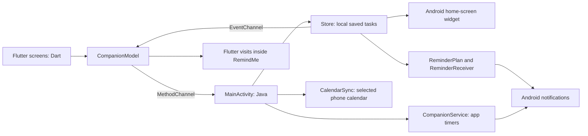

# RemindMe Companion

RemindMe is an Android task app with small animated animal companions. A companion walks in, shows a reminder, optionally plays a sound or your recording, and walks away. Visits happen inside RemindMe; background reminders use Android notifications.

This guide has two main parts:

- [Part 1 — The code and how the app is built](#part-1--the-code-and-how-the-app-is-built): languages, files, architecture, development, builds, and checks.
- [Part 2 — App features and how to use them on your phone](#part-2--app-features-and-how-to-use-them-on-your-phone): installation, tasks, companions, voices, timers, calendars, and the home-screen widget.

## Part 1 — The code and how the app is built

### Languages and responsibilities

| Technology | What it does in this project |
| --- | --- |
| Dart | Defines the app’s screens, data models, settings, and visit behavior. |
| Flutter | Draws the interface, pixel animals, text bubbles, and animations from Dart code. |
| Java | Connects the app to Android calendars, notifications, app-usage monitoring, recording, audio, and launcher widgets. |
| XML | Declares Android permissions, themes, and home-screen widget layouts. |
| Gradle / Kotlin build scripts | Configure Android dependencies, compilation, packaging, and signing. The native app logic is Java. |
| Bash / Python | Run previews, build APKs, prepare sound assets, and check release artifacts. |

The active app is in `companion_flutter/`. The top-level `app/` also contains the original Java interface, kept for reference, and resources shared with the Flutter app. Use `scripts/build_flutter_apk.sh` for the current app; `scripts/build_apk.py` builds the older Java interface.

The browser preview runs the same Flutter interface. A small JavaScript bootstrap file starts it; the screens themselves are written in Dart.

### Where to find the code

Paths below are relative to the repository root.

| File or folder | Start here to understand… |
| --- | --- |
| `companion_flutter/lib/main.dart` | `RemindMeApp`, bottom navigation, `tasksPage()`, `companionsPage()`, `timersPage()`, and task/timer editors. |
| `companion_flutter/lib/companion_model.dart` | `Pet`, `Task`, `TimerRule`, `VoiceClip`, and the `CompanionModel` operations that load and save data. |
| `companion_flutter/lib/companion_editor.dart` | The Look, Bubble, Movement, and Voice sections, draft previews, and the recording dialog. |
| `companion_flutter/lib/animal_catalog.dart` | Stable animal IDs, labels, descriptions, and suggested colors. |
| `companion_flutter/lib/pixel_cat.dart` | `PixelCat` and `AnimalPainter.paint()`, which draw all eleven animals. |
| `companion_flutter/lib/animal_voices.dart` | The voice styles and `AnimalVoicePicker.pick()`, which chooses random sound variations. |
| `companion_flutter/lib/visit_overlay.dart` | `VisitController`, `VisitHost`, and `VisitOverlay`: queuing, movement, reading time, and foreground visibility. |
| `companion_flutter/lib/voice_backend.dart` | Selects the Android or browser audio implementation. |
| `companion_flutter/lib/voice_backend_native.dart` | Dart calls into Android audio and recording. |
| `companion_flutter/lib/voice_backend_web.dart` | Browser file selection, recording, audio, and speech. |
| `companion_flutter/lib/app_style.dart` | Shared colors, panels, sliders, and other reusable UI helpers. |
| `companion_flutter/lib/task_widget_preview.dart` | An interactive Flutter preview of the Android home-screen widget. |
| `companion_flutter/android/app/src/main/java/com/remindme/companion/` | `MainActivity.java` bridges Dart and Android; `VoiceCapture.java`, `InAppSpeech.java`, and `FlutterVoiceAssets.java` handle foreground audio. |
| `native-core/src/main/java/com/remindme/companion/` | Shared Android task storage, calendar integration, reminder scheduling, app timers, recording-file checks, and home-screen widget behavior. |
| `app/src/main/res/` | Shared widget layouts, widget metadata, icons, and themes. |
| `companion_flutter/pubspec.yaml` | Flutter dependencies, fonts, sound assets, and app version. |
| `scripts/` | Preview, build, sound-generation, and artifact-checking tools. |
| `companion_flutter/test/`, `companion_flutter/tool/`, and `tests/` | Flutter tests, off-screen visual renders, Java checks, and Python build/privacy checks. |

A **Flutter widget** is a UI building block, such as a button or screen. The **Android home-screen widget** is a separate Android feature built with `RemoteViews`; the Flutter preview helps you inspect its design inside the app.

### How the parts work together



A `MethodChannel` carries a request from Dart to Java inside the app. An `EventChannel` sends changes back to Flutter. Neither is a network connection.

For example, saving a task follows this path:

1. The task editor creates a `Task`, including its chosen `companionId`.
2. `CompanionModel.upsert()` calls `_persistTask()`. On Android, this sends an `upsertTask` message to `MainActivity.java`.
3. Java updates the task through `Store`, manages its calendar/reminder work, and refreshes the home-screen widget. Task-change events keep Flutter synchronized.

In the browser, the model saves locally through `SharedPreferences`; phone-calendar access and real phone-usage monitoring require Android.

### Saved data and upgrade behavior

`toJson()` and `fromJson()` convert the Dart models to and from saved data. Each companion has a stable ID. Tasks and timers store that ID, so renaming a companion does not break their assignments.

The companion editor works on a draft copy. Previewing or moving a slider changes that draft; **Save companion** writes it. Missing fields in older saved profiles receive compatible defaults. Existing profiles without `voicePreset` keep the `custom` source, preserving their previous recording/system-voice behavior.

Android stores imported recordings as private files. The browser keeps imported audio with its local workspace and can hit browser storage limits for large clips. `VoiceFiles.java` validates Android recording files and prevents deletion of a clip still referenced by a saved companion.

Calendar-linked tasks store calendar/event IDs alongside reminder fields such as `dailyDays`, `reminderOffsets`, `lastReminderAt`, `reminderFrom`, and `snoozeUntil`. The `due` value remains the deadline. Keeping snooze separate lets the app delay a reminder without moving the linked calendar event.

### Companion artwork, animation, and sound

All eleven animal designs use the same **36 × 40 pixel grid**. `AnimalPainter.paint()` builds them from sharp-edged shapes, stepped outlines, highlights, and shadows. Body and accent colors remain editable because the artwork is drawn in code.

Walking uses four poses over a 640 ms cycle. Idle movement uses a slower 3.84-second breathing/blinking cycle. Individual designs add characteristic movement: bunnies and frogs hop, penguins waddle, turtles keep their shells level, and the monkey moves its arms and curled tail. The renderer respects reduced-motion settings.

The visit controller queues reminders. A visit enters, pauses with its text and optional audio, waits for both the reading time and audio completion, then exits. The bubble fades without changing the pet’s vertical position. Foreground/lifecycle handling hides visits and stops their speech when the app is left.

`animal_voices.dart` defines three sound styles per animal, with three variations each: **99 bundled MP3s**. `AnimalVoicePicker.pick()` excludes the last clip played for that companion, animal, and style, including between task and timer visits. The selection history resets when the app restarts.

For Android, Dart sends the chosen clip as a playback override. `FlutterVoiceAssets.java` accepts only the known bundled asset names, and `InAppSpeech.java` plays the sound before optional system speech. The original custom recording paths stay saved when a preset is selected. Browser playback loads the same files through Flutter’s asset bundle.

The home-screen widget is implemented separately: `TaskWidgetProvider` fills `task_widget.xml` and `task_widget_row.xml`; completion calls `Store.complete()`. `task_widget_info.xml` controls its initial size and resize limits. The launcher decides the actual grid sizes.

### Run the browser preview

Install Flutter stable and make it available on `PATH`. The wrapper also supports a project-local Flutter installation in `.tools/flutter`.

From the repository root:

```sh
./scripts/flutterw pub get
./scripts/preview_flutter.sh
```

Open [the local preview](http://127.0.0.1:8942). In the running Flutter terminal, use `r` to hot reload or `R` to hot restart. Browser tasks and companion settings persist in that browser; example tasks can be cleared from Tasks.

The preview supports companion designs, visits, settings, and browser-supported audio. Browser recording needs microphone permission and a supported recording format. Real app timers, phone calendars, background Android notifications, and launcher widgets need a phone.

### Build the current Android app

The existing build setup uses Android SDK platforms 35 and 36, Build Tools 36.0.0, NDK 28.2.13676358, CMake 3.22.1, and Java 17. Use Android Studio’s SDK Manager and [Flutter’s Android setup guide](https://docs.flutter.dev/platform-integration/android/setup) to configure the SDK and accept its licenses.

Run:

```sh
./scripts/build_flutter_apk.sh
```

The ARM64 APK is written to `dist/RemindMe-Flutter-arm64.apk`, with a matching `.sha256` checksum. This build is suitable for the POCO X7 Pro and other compatible ARM64 phones.

The build script:

1. Resolves Flutter dependencies.
2. Builds the release APK with obfuscation, separate debug symbols, and native snapshot stripping.
3. Runs `scripts/audit_apk.py` before copying the APK into `dist`.
4. Refreshes the APK checksum.

`scripts/portable_flutter_build.py` temporarily gives Flutter’s generated plugin-registration directory a package alias. This keeps a developer’s absolute build-folder path out of the compiled APK. It restores the generated package configuration afterward and does not modify the Flutter SDK.

Debug symbols remain in an ignored, timestamped `.tools/build-symbols` directory. Keep the symbols matching each shared APK privately so crash traces can be decoded. See [Flutter’s obfuscation and symbol guidance](https://docs.flutter.dev/deployment/obfuscate).

Test builds use the existing local development signing key when available. Preserve `.tools/debug.keystore` to keep installing updates over previous test builds. Production signing needs a separate private key and local configuration. The `android` password in development tooling is the standard Android debug-key default; the signing key itself is not committed.

### Local configuration and artifact privacy

Scripts derive the project location from their own files. SDK/tool locations come from `PATH`, `ANDROID_HOME`, `ANDROID_SDK_ROOT`, generated `local.properties`, or optional project-local caches. Developer-specific absolute paths do not belong in tracked configuration.

`.gitignore` excludes local environment files, private-key formats, signing configuration, database exports, debug symbols, caches, and `.tools`. Keep credentials, personal recordings, exported task data, and signing keys out of Git. An optional `.env.example` should contain placeholders only.

The APK audit rejects home-folder paths, private-key markers, access-token patterns, credential-bearing URLs, and private configuration filenames inside the archive. This is a focused check, not a guarantee that an artifact contains no sensitive information. Historical Flutter test APK downloads were withdrawn during the privacy cleanup because they contained a generated local build path; their release tags still provide source code.

### Checks and what still needs a phone

Run the Flutter and build/privacy checks from the repository root:

```sh
./scripts/flutterw analyze
./scripts/flutterw test
python3 tests/ArtifactPrivacyTest.py
```

Run the shared Java logic checks:

```sh
mkdir -p build/tests
javac -d build/tests \
  native-core/src/main/java/com/remindme/companion/UsageSession.java tests/UsageSessionTest.java \
  native-core/src/main/java/com/remindme/companion/VisitMotion.java tests/VisitMotionTest.java \
  native-core/src/main/java/com/remindme/companion/ReminderPlan.java tests/ReminderPlanTest.java
java -cp build/tests UsageSessionTest
java -cp build/tests VisitMotionTest
java -cp build/tests ReminderPlanTest
```

Generate screen and animal-pose images in `.tools/`:

```sh
./scripts/flutterw test tool/render_animals_test.dart tool/render_preview_test.dart
```

Flutter tests cover saved-data compatibility, companion/task/timer assignments, recording-dialog wiring, voice assets and random selection, calendar UI, responsive layouts, visit timing, and background visibility. Java tests cover usage timing and reminder scheduling, including daylight-saving changes. Python checks cover APK privacy detection and restoration of temporary build configuration. Off-screen renders are useful for layout review; they are not phone screenshots.

A real phone is still needed to verify:

- Installation/upgrades, animation pacing, touch controls, and larger text settings.
- Microphone recording, imported audio, built-in sounds, optional speech, and interruption when switching apps.
- Actual notification timing, notification/exact-alarm permission changes, and battery-management behavior.
- Calendar insert/update/delete operations, Outlook calendar availability, and permission denial/revocation.
- Real app-usage monitoring and launcher widget placement, resizing, and completion controls.

### Sound sources and rebuilding the voice bank

The three styles are pitch/timing edits of source sounds. Cats, dogs, penguins, and monkeys use three source calls per style. Other styles use rhythmic variations of a source call. Rabbit clips use nibbling/rustling; turtle clips are original synthesized chirps. SFXMint clips are stylized AI-generated effects, and the monkey clips are performed imitations.

| Source | Credit / license |
| --- | --- |
| [Cat SFX](https://opengameart.org/content/cat-sfx) | SFX by Dan Knoflicek — CC BY 3.0 |
| [Penguin SFX](https://opengameart.org/content/penguin-sfx) | Wolfgang Wozniak — CC BY 3.0 |
| [Dog sounds](https://opengameart.org/content/dog-sounds) | pauliuw — CC0 |
| [Rabbit Eating](https://opengameart.org/content/rabbit-eating) | Voltiment555 — CC0 |
| [Monkey Sounds](https://opengameart.org/content/monkey-sounds) | AntumDeluge — CC0 |
| SFXMint animal sounds | [CC0 license](https://sfxmint.com/license); individual source URLs are in the manifest. |
| Turtle chirps | Original project synthesis — CC0 |

The app’s **Sound sources & credits** dialog displays the credits. `companion_flutter/assets/audio/animal_voices/CREDITS.txt` and `manifest.json` contain attribution, source/license URLs, transformations, and input/output SHA-256 hashes.

The generated MP3s are committed, so an ordinary app build does not need ffmpeg or the original sound cache. To regenerate them, install ffmpeg and place the source files listed in the manifest under `.tools/animal-audio-sources`:

- Save Cat 1–3 WAVs as `cat1.wav`–`cat3.wav` and RabbitEating.wav as `rabbit.wav`.
- Extract `dog.7z` into `dog/` and `Penguin_sfx.zip` into `penguin/`.
- Save the five SFXMint MP3s using their animal IDs as filenames. Respect the source download limits.
- Extract the CC0 `monkey-sounds_0.zip` archive, including its `LICENSE.txt`, into `monkey-cc0/`.

```sh
python3 scripts/build_animal_voices.py
# Or rebuild only the monkey clips and retain the other animals:
python3 scripts/build_animal_voices.py --animal monkey
```

The generator makes no network requests. Pixel-art guidance came from the [Pixel Art Sprites skill](https://github.com/Dizzd/aseprite-extension-mcp/tree/main/skills/pixel-art-sprites); the animal designs are drawn in this project.

### A beginner-friendly reading order

1. Start with `RemindMeApp` and the three page functions in `main.dart` to see how screens are assembled.
2. Read `Pet`, `Task`, and `TimerRule` in `companion_model.dart`, then their `toJson()` / `fromJson()` methods.
3. Follow `CompanionModel.upsert()` → `_persistTask()` → the Android `MainActivity` handler → `Store.upsert()` / `Store.save()`.
4. Read `companion_editor.dart` to see how a draft changes before saving.
5. Read `AnimalPainter.paint()` for pixel drawing and `AnimalVoicePicker.pick()` for non-repeating sound choices.
6. Read the visit controller and overlay, then compare Dart’s `Task.reminderTimes()` with Java’s `ReminderPlan.times()`.

For a small first exercise, change `green` in `app_style.dart` and hot reload. Changing a default in code does not overwrite a companion’s already-saved settings.

## Part 2 — App features and how to use them on your phone

### Install and open RemindMe

Install a current `RemindMe-Flutter-arm64.apk` supplied by the maintainer or built using [the Android build instructions](#build-the-current-android-app). If Android asks, allow installation from the app opening the APK. Older release tags may have source code without an APK because historical test downloads were withdrawn during the privacy cleanup.

Install updates over the existing app using the same signing key to retain your tasks, companions, settings, and recordings. Uninstalling the app or clearing its storage removes locally stored data.

The bottom navigation has three pages:

| Page | What you use it for |
| --- | --- |
| **Tasks** | Create tasks, set reminders, connect calendars, and add the home-screen widget. |
| **Companions** | Create animals, customize their appearance/voice, and enable in-app visits. |
| **App timers** | Choose apps to watch and set time limits for reminder nudges. |

### First-time setup and permissions

1. Open **Companions** and turn on **Enable companion visits**.
2. Under **Permissions**, allow **Task notifications**.
3. Allow **Precise reminder timing** if you want more precise scheduled delivery.
4. Tap a companion’s **Test visit** button to see an example inside RemindMe.

Other permissions are needed only for the features you choose:

| Permission | When it is used |
| --- | --- |
| Notifications | Background task and app-timer reminders. |
| Precise reminder timing | More precise scheduled task reminders; the fallback can be delayed. |
| App-usage access | Monitoring the phone apps selected in an app-timer rule. Grant it from **App timers**. |
| Calendar access | Reading writable phone calendars and managing events for tasks you link. |
| Microphone | Recording your own audio, requested when you press **Record**. |

Companions and their voices appear only while you use RemindMe. They hide and stop speaking when you leave it. Background reminders use notifications; no floating-window permission is needed.

### Create tasks and set reminders

1. Open **Tasks** and tap **Add task**.
2. Enter a title and list, then choose the **Reminder companion**.
3. Tap **Set deadline and reminders** if the task needs a date and time.
4. Choose **Daily reminders start**, such as three days before the deadline, or choose no daily reminders.
5. Add optional **Extra reminders (hours before)**, such as `3, 1, 0.5` for three hours, one hour, and thirty minutes before the deadline.
6. Save the task.

Daily reminders use the deadline’s time of day and can begin up to 30 days before it. The app also reminds at the deadline. Newly saved plans skip slots already in the past; delayed delivery produces one catch-up reminder instead of many at once.

Complete a task to stop its future reminders. Reopening it schedules the remaining future reminders. **Snooze** adds a later reminder without changing the deadline or moving a linked calendar event.

### Create and customize a companion

Open **Companions → Add companion**, enter a name, and choose an animal:

**Cat, Dog, Bunny, Fox, Bear, Panda, Frog, Penguin, Owl, Monkey, or Turtle.**

Tap **Customize** on an existing companion to edit it. Its settings are organized into four sections:

| Section | Available settings |
| --- | --- |
| **Look** | Name, animal, body/accent colors, size, and opacity. |
| **Bubble** | Font, text size/color, bubble color, rounded corners, and reading time. |
| **Movement** | Entrance side, stopping position, screen height, and walking speed. |
| **Voice** | Built-in sounds, custom recordings, system speech, volume, speech speed, and pitch. |

Switching animals keeps your selected colors. Tap **Use suggested colors** to apply that animal’s suggested palette. The preview’s **Idle**, **Walk**, and **Talk** choices show its animation. The top-right play button tests a complete reminder visit with your draft settings.

Tap **Save companion** to keep the changes. Use **Make default** on a companion’s card to select it for new tasks. Individual tasks and timers can still choose another companion.

Removing a companion moves its assigned tasks and timers to another companion; it does not delete those tasks. The app keeps at least one companion.

### Choose a voice or add your own

Open **Companions → Customize → Voice**.

For built-in sounds:

1. Choose **Soft**, **Bright**, or **Low** sounds for the selected animal.
2. Tap the play button beside a style to hear a sample; tap it again to stop.
3. Adjust **Voice volume**.
4. Optionally enable **Read reminder text after the sound**.
5. Save the companion.

Each built-in style has three offline clips. Visits randomly select a variation and avoid playing the same one twice in a row while the app is running. Selecting a voice source enables that companion’s voice; newly created companions otherwise begin with voice playback off.

For your own audio, select **My recordings**, then **Record** or **Import** under **Task reminders** or **App-timer nudges**. You can use a different clip for each reminder type. Each clip can be up to **60 seconds and 5 MB**. Android keeps imported originals and copies the selected audio into the app’s private storage.

Custom recordings play as recorded; there is one saved custom clip per reminder type. Switching to a built-in style keeps those recordings, and choosing **My recordings** restores them. With no custom clip, an enabled voice reads the reminder using the phone’s system voice. Choose **System voice only** to use that speech without an animal sound.

The built-in choices are sound-designed styles with pitch and timing variations. Rabbit sounds are nibbling/rustling, monkey sounds are performed imitations, and turtle sounds are cartoon chirps. The settings explain these differences and provide **Sound sources & credits**. This feature does not clone a voice.

The text bubble always shows the actual reminder. A visit waits for both its reading time and audio to finish before leaving. Multiple visits queue instead of overlapping.

### Set an app timer

1. Open **App timers** and grant **App-usage access**.
2. Tap **Add app timer**.
3. Give the timer a name, choose a companion, and set its time limit.
4. Choose the apps to watch, save, and enable the rule.
5. Keep **Enable companion visits** turned on in **Companions**.

Each timer has its own selected apps, limit, companion, and enable switch. Use **Test visit** to preview its companion. Phone-usage monitoring runs on Android; the browser preview uses example apps.

When you are outside RemindMe, timer nudges use notifications. The monitoring service does not draw pets or play reminder speech over other apps.

### Link a task to your phone calendar

1. On **Tasks**, tap **Connect phone calendar** and allow calendar access.
2. Add or edit a task with a deadline.
3. Under **Put task in calendar**, choose a writable phone calendar and save.

The app creates one 15-minute event at the deadline. Editing the deadline updates the linked event. Completing the task adds a checkmark to the event title; deleting the task or removing its calendar link removes the event RemindMe created.

Only calendars already exposed by Android are listed. For Outlook, enable the account’s **Sync calendars** option first; see Microsoft’s [calendar sync guide](https://support.microsoft.com/en-us/outlook/how-do-i-sync-my-outlook-calendar-to-the-default-calendar-app-s). Account or administrator restrictions can prevent a writable calendar from appearing.

Calendar linking is one way: edits made in Calendar or Outlook are not imported into RemindMe. The entries are calendar events, not Microsoft To Do tasks. RemindMe handles its repeated reminders; the calendar provider may apply its own default alerts.

If a calendar update fails, the task remains saved locally and shows the error. If permission is revoked, reconnect before removing a linked event.

### Add the home-screen widget

On **Tasks**, tap **Home-screen widget** to request placement. You can also open your launcher’s Widgets picker and add **RemindMe tasks**.

Use the widget’s top-right add button to create a task, and the circle beside a row to complete it. Rows show the task title and list/group. Delete tasks inside the app.

Long-press the widget and drag its side or bottom handles to resize it. Your launcher determines the available sizes. If an older widget keeps its previous width limit, remove only the widget from the home screen and add it again; the tasks remain in RemindMe.

### Privacy, storage, and troubleshooting

The Android release has no account, backend, analytics, or internet permission. Tasks and companion settings are stored locally. Built-in sounds work offline. Calendar events you explicitly link may sync through the selected calendar account, and system speech follows your phone’s installed text-to-speech engine and settings.

| If something does not work | What to check |
| --- | --- |
| No companion appears | Turn on companion visits, return to RemindMe, and try **Test visit**. Pets do not appear over other apps. |
| Background reminders are missing or late | Check notification permission and precise reminder timing. Battery policies and force-stopping can affect delivery; reopening RemindMe reschedules saved reminders. |
| A calendar is missing | Check calendar permission and whether the account exposes a writable calendar through Android. |
| A voice is silent | Check the companion’s voice switch, volume, selected source, clip playback, and the phone’s text-to-speech engine if using system speech. |
| Recording does not start | Allow microphone access, or import an audio file instead. |
| A widget will not resize as expected | Use the launcher’s resize handles, or remove and re-add only the widget. |

Without precise timing access, Android uses an inexact alarm fallback that may be delayed. See Android’s [alarm scheduling guidance](https://developer.android.com/develop/background-work/services/alarms) for the platform behavior.
