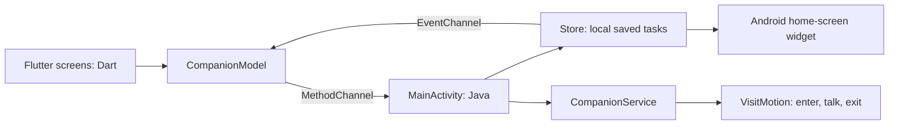

# RemindMe Companion

A Flutter Android task app with companions that walk in, stop to deliver a reminder, and then walk off-screen. Each task and app timer can use a different named companion. A compact Android home-screen widget shows a title and top-right add button, with a completion circle and group subtitle on each row.

## What you can configure

The bottom navigation has **Tasks**, **Companions**, and **App timers**. There are no page-switching buttons in the header. Individual companion settings open from that companion’s card.

- Create and name multiple companions. Choose cat, dog, bunny, or fox, with independent body and accent colors.
- Customize size, opacity, bubble colors, font family/size, rounded corners, walking speed, entrance side, stopping position, vertical position, and reading time.
- Record or import separate audio clips for task reminders and app-timer nudges. Clips are limited to 60 seconds and 5 MB. Recording asks for microphone permission only when you press Record. Imported originals are kept; Android copies selected audio into the app’s private files.
- Enable or disable each companion’s voice, set volume, and optionally read the reminder text after a custom clip using the system voice. Without a clip, an enabled voice reads the reminder through system text-to-speech. Clips play as recorded; this is not voice cloning.
- Select a companion on each task and each app-timer rule. Each rule has its own watched apps, time limit, and enable switch.
- The pet enters from an edge, pauses with its bubble and optional audio, waits for both reading time and audio completion, then continues off the opposite edge. Multiple reminders queue instead of overlapping.
- Removing a companion reassigns its tasks and timers; it does not delete those tasks. At least one companion is kept.

The app has no account, backend, analytics, or internet permission in the Android release. Tasks and companion settings are stored locally. Android speech follows the phone’s installed text-to-speech engine and its settings.

## Develop and preview

Install Flutter stable, then run these commands from the repository root:

```sh
./scripts/flutterw pub get
./scripts/preview_flutter.sh
```

Open **http://127.0.0.1:8942**. This runs the actual Dart interface in a browser. Use `r` in the running Flutter terminal to hot reload and `R` to hot restart. Browser tasks and companion settings persist in this browser. Existing example tasks can be cleared from Tasks.

Browser visits are simulated inside the browser window. Android handles floating over other apps and real phone-usage monitoring. Browser audio import and recording depend on the browser’s supported formats and microphone permissions. Large clips may exceed browser local-storage limits; Android stores clips as files instead.

## Build the Flutter Android APK

```sh
./scripts/build_flutter_apk.sh
```

The ARM64 result is `dist/RemindMe-Flutter-arm64.apk`, suitable for the POCO X7 Pro. The first build needs Android SDK platforms 35 and 36, Build Tools 36.0.0, NDK 28.2.13676358, and CMake 3.22.1. Android Studio’s SDK Manager can install them; follow [Flutter’s Android setup](https://docs.flutter.dev/platform-integration/android/setup) for SDK configuration and licenses.

Test builds use the existing local development key when available. Keep `.tools/debug.keystore` to install future versions as updates. Keys, SDKs, caches, recordings, and large Flutter APKs are not committed. Test APKs are shared through private GitHub release assets.

After installation, open **Companions → Permissions** and grant floating-pet and notification access. Enable companion visits. Open an individual companion’s settings to customize it, record/import audio, and try a task or timer visit. For real app timers, also grant usage access under **App timers**. Use the **Home-screen widget** button on Tasks to request widget placement or add **RemindMe tasks** from the launcher’s Widgets picker. Long-press the placed widget and drag the side handles to change width, or the bottom handle to change height. It defaults to three columns rather than four, with a 110dp minimum resize width; the launcher chooses its grid sizes. If an existing widget keeps the old width limit, remove only the widget from the home screen and add it again. Tasks stay in the app. Delete tasks inside the app; widget rows keep only the completion control.

On HyperOS, a hidden/stopped overlay may require per-app pop-up/background-window or battery settings. Menu names vary; Xiaomi documents the extra controls in its [permission guide](https://www.mi.com/global/support/faq/details/KA-497759/).

## Learn the code: languages and structure

**Dart** is the language of the main app. **Flutter** is the framework that draws its screens and animations. **Java** connects the Flutter app to Android features such as overlays, usage events, widgets, recording, and audio. **XML** declares Android permissions, widget layouts, and themes. The `.gradle.kts` files use **Kotlin syntax to configure the build**; the native app logic is currently Java. **Bash/Python** scripts automate development and packaging. A small JavaScript file starts the Flutter browser preview; the app UI is not hand-written HTML/JavaScript.

```text
companion_flutter/
  lib/
    main.dart                  App entry point, bottom tabs, tasks and app timers
    companion_model.dart       Pet, Task, TimerRule and VoiceClip data; persistence
    companion_editor.dart      Individual companion settings and recording dialog
    pixel_cat.dart             Four animated animal designs, drawn with a Canvas
    app_style.dart             Shared colors and reusable visual components
    visit_overlay.dart         Browser visit queue and entry/talk/exit animation
    voice_backend.dart         Chooses the Android or browser audio implementation
    voice_backend_native.dart  Dart calls into Android recording/import/playback
    voice_backend_web.dart     Browser recorder, file picker, audio and speech
    task_widget_preview.dart   Interactive preview of the home-screen widget
  android/app/src/main/java/com/remindme/companion/
    MainActivity.java          MethodChannel/EventChannel bridge between Dart and Java
    VoiceCapture.java          Android microphone, file picker and audio audition
  pubspec.yaml                 Dependencies, fonts, assets and app version
  test/companion_test.dart     Behavior and UI tests
  tool/render_preview_test.dart  Off-screen rendering for visual review
native-core/src/main/java/com/remindme/companion/
  Store.java                  Shared task persistence and mutations
  PetProfile.java             Android companion settings and timer-rule decoding
  CompanionService.java       Foreground scheduler, overlay window, voices and visits
  VisitMotion.java            Pure enter → talk → exit state machine
  CatView.java                Android Canvas animal renderer
  UsageSession.java           Counts uninterrupted time in chosen apps
  ReminderReceiver.java       Schedules/delivers task reminder notifications
  TaskWidgetProvider.java     Home-screen widget layout, refresh and button actions
  TaskWidgetService.java      Collection adapter for older Android/large task lists
  WidgetAddActivity.java      Small native widget quick-add dialog
  VoiceFiles.java             Private audio file validation and safe cleanup
app/src/main/res/              Shared Android widget XML, icon and themes
scripts/                      Preview/build command wrappers
```

The top-level `app/` also contains the **original Java interface**, kept for reference. It is not the active Flutter interface. `scripts/build_apk.py` builds that older interface; use `scripts/build_flutter_apk.sh` for the current app. Shared native code/resources serve both builds.

### A reading order

1. In `main.dart`, read `main()`, `RemindMeApp`, and the `NavigationBar`. Follow `tasksPage()`, `companionsPage()`, and `timersPage()` to see which widgets draw each page.
2. Read `Task`, `Pet`, and `TimerRule` in `companion_model.dart`. Each object has fields and `toJson()`/`fromJson()` methods that convert between Dart objects and saved data. `companionId` is a reference to a pet’s stable ID; renaming the pet does not require rewriting every task.
3. Follow `CompanionModel.upsert()` into `_persistTask()`. On Android it sends `upsertTask` through a `MethodChannel`. In the browser it saves locally.
4. Find the `upsertTask` case in `MainActivity.java`, then `Store.upsert()` and `Store.save()`. Java changes one stored task and refreshes the widget. An `EventChannel` sends task changes back to Flutter, keeping the screens synchronized.
5. Read `VisitMotion.java`: the enum names the phases and `tick()` advances between them. This small class has no Android dependency, making the behavior easy to test. Then see how `CompanionService` uses the result to position an Android overlay window.
6. Read `companion_editor.dart` for customization. The editor uses a draft copy, so sliders change the preview before you save. `voice_backend.dart` uses a conditional export to select native or web audio code.



A **widget** in Flutter is a building block such as a button, row, or screen. The **Android home-screen widget** is a different feature built with Android `RemoteViews`; `task_widget_preview.dart` is its interactive visual counterpart. A **model** is the app’s data and operations. A **service** is Android code that can continue working while the main screen is not open. A **platform channel** is a direct message bridge within the app, not a network request.

For a small first exercise, change `green` in `app_style.dart`, hot reload, and inspect the app’s buttons. Then read `PixelCat` and `AnimalPainter` to see how rectangles become a pixel animal. Changing defaults in code does not overwrite a companion’s already-saved settings; use the companion editor to change existing companions.

## Checks

```sh
./scripts/flutterw analyze
./scripts/flutterw test
mkdir -p build/tests
javac -d build/tests native-core/src/main/java/com/remindme/companion/UsageSession.java tests/UsageSessionTest.java native-core/src/main/java/com/remindme/companion/VisitMotion.java tests/VisitMotionTest.java
java -cp build/tests UsageSessionTest
java -cp build/tests VisitMotionTest
```

The Flutter tests cover migration, persistence, task/timer assignments, companion deletion, native mutation messages, task/widget actions, recording-dialog wiring with a mocked recorder, bottom navigation, responsive layouts, and visit timing. They do not record a real microphone. The Java tests check usage timing and visit motion independently of Android.

For rendered screen images in `.tools/`, run `./scripts/flutterw test tool/render_preview_test.dart`. They are off-screen Flutter renders, not phone screenshots.

A real phone check is still required for microphone hardware, file-provider support, overlay behavior, notification timing, usage-access delivery, and launcher widgets. Test a short recording and an imported clip for both reminder roles, two pets assigned to different tasks/timers, both entrance directions, large text, queued reminders, completing/snoozing, and widget changes. Android battery saving can delay scheduled notifications; enabling visits does not provide exact-alarm guarantees. Start visits again after restarting the phone.

## Compact widget layout (0.3.1)

The actual Android widget is drawn by `app/src/main/res/layout/task_widget.xml` (header and list) and `task_widget_row.xml` (completion circle, title, group). `res/xml/task_widget_info.xml` controls default size and minimum resize dimensions. `TaskWidgetProvider.row()` fills in the task title and existing `list` value, while its completion action still calls `Store.complete()`. This changes presentation and sizing, not the saved task format. The Dart file `task_widget_preview.dart` mirrors the design for the in-app/browser preview. Android resizing is performed by the launcher, not by Flutter.
